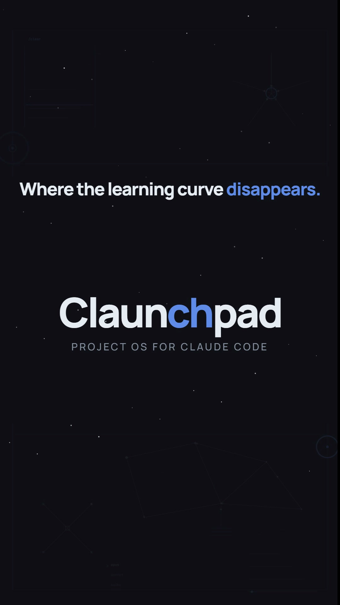

<p align="center">
  
</p>

# Claunchpad

<p align="center">
  <a href="https://github.com/captkernel/Claunchpad/raw/master/docs/video/claunchpad-reel.mp4">
    
  </a>
  <br><em>37 seconds: where the learning curve disappears. — <a href="https://github.com/captkernel/Claunchpad/raw/master/docs/video/claunchpad-reel.mp4">9:16 reels</a> · <a href="https://github.com/captkernel/Claunchpad/raw/master/docs/video/claunchpad-reel-4x5.mp4">4:5 feed</a></em>
</p>

**▶ [See the interactive showcase](https://htmlpreview.github.io/?https://github.com/captkernel/Claunchpad/blob/master/showcase.html)**

**Drop in one skill and Claude starts working like someone who knows what they're doing,
without you setting any of it up.** Claunchpad turns on persistent memory, agent teams that size
themselves, the good ecosystem skills, and the habits that otherwise take weeks to work out on
your own. Nothing to configure, nothing to learn. You add it, answer one question, and it runs.

It's the setup most people rebuild by hand on every project, packaged: a solid `CLAUDE.md`, a
memory that's shared across agents and survives a reset, sensible rules for when to bring in
help, decision frameworks, and a one-tap install of the best tools, built around how Claude
actually behaves.

## Install

The skill folder is identical on every surface; only delivery differs.

**Claude Code (plugin, recommended):**
```
/plugin marketplace add captkernel/plugins
/plugin install claunchpad@captkernel
```
Then it auto-triggers from its description, or invoke it explicitly.

**Claude Code (manual copy):** copy the skill folder into your skills directory:
```bash
cp -r skills/claunchpad ~/.claude/skills/          # available in all projects
# or, per-project:
cp -r skills/claunchpad <your-repo>/.claude/skills/
```

**claude.ai** (Pro/Max/Team/Enterprise), upload `skills/dist/claunchpad.zip` via
**Settings → Capabilities → Skills**, or add it to a Project. (No filesystem there, so it
applies the behavior in-session and hands you the templates to paste.)

**Claude API**, upload via the skills endpoint and reference it by id (requires the current
skills/code-execution beta headers).

## What it runs, reads and sends

**Files it writes into your project** (from `skills/claunchpad/templates/`, after the first-run
interview, and never overwriting existing config destructively):
- `CLAUDE.md` and `MEMORY.md` (all tiers); per-fact files under `memory/` and a
  `.claunchpad/handoff.md` buffer (Pro, or when a Standard project graduates).
- `.claude/settings.json` from the starter, standard or pro template. It only registers hooks,
  and edits to an existing file are additive.
- `.claude/hooks/load-memory` (all tiers), `.claude/hooks/harvest-nudge` (Standard and up) and
  `.claude/hooks/recall` (Pro). The hooks keep small flag files in `.claunchpad/`
  (`.harvest-nudged`, `.recalled`).

**What the hooks do.** All three are short local POSIX shell scripts you can read in full.
`load-memory` reads `.claunchpad/handoff.md`, pinned and recent `memory/*.md` files and the
`MEMORY.md` index from your project, within a size budget, and hands them to Claude as session
context with a short memory-health report. `recall` adds the facts that match each prompt.
`harvest-nudge` blocks once per session to remind Claude to file new learnings. No hook makes a
network call, and none writes to your memory.

**Network, only if you say yes.** Claunchpad itself sends nothing anywhere. At bootstrap it
offers to install three third-party tools (`templates/recommended-skills.md`). Nothing runs
unless you accept (`[Y] all · [c] customise · [s] skip`), and you can pick a subset:
- **Superpowers**: `claude plugin marketplace add obra/superpowers-marketplace`, then
  `claude plugin install superpowers@superpowers-marketplace`.
- **Skills Curator**: `git clone https://github.com/captkernel/Skills_Curator`, then run its
  `install.sh` (or `install.ps1` on Windows).
- **Agent Browser**: `npm install -g agent-browser`, then `agent-browser install`, which
  downloads a Chrome for Testing build. Skipped if Node is missing.

Each of those fetches code from the network, and a restart of Claude Code is needed before they
activate. Decline the offer and no third-party code is installed.

## What one install turns on

You get all of this automatically. **No expertise required.**

- **🧠 Persistent memory**: Claude remembers your project across `/clear` and context
  compaction: the decisions you made and why, the bugs you already fixed, the techniques that
  work here. No note-taking discipline needed, a hook reloads it at the start of every
  session, so Claude never starts from zero again.
- **👥 Agent team structures**: work runs as a team that sizes itself: a solo pass for small
  things, a builder-plus-reviewer pair for real changes, parallel agents for independent
  research, a scripted assembly line for big migrations. You don't pick the structure;
  Claunchpad escalates only when the task earns it and drops back the moment it doesn't.
- **✉️ Knowledge-passing between agents**: agents don't work in the dark. The orchestrator
  injects the memory that matters into each agent's brief and harvests their findings back into
  the shared memory, so every agent builds on what the others learned instead of repeating it.
- **🧩 The best skills, one tap**: at setup, Claunchpad offers to install the high-value
  ecosystem skills (**Superpowers**, **Skills Curator**, **Agent Browser**) the right way for
  your machine. **Skills Curator is deeply integrated as the curation layer**: every other skill
  is evaluated, security-scanned, and *rebuilt for your project* through its `--customize`,
  decomposed, with only the parts that fit your stack kept and rewritten in your voice.
  *Infuse, don't invoke.*
- **✅ Best-practice guardrails**: the stuff experienced users do without thinking, on by
  default: spend agents only when they pay off (multi-agent runs cost ~15× the tokens), never
  call work "done" without an independent review and verification, put cheap models on cheap
  jobs, and stop to pressure-test big, irreversible decisions.
- **🎚️ Tuned to you**: a beginner gets a tiny, safe setup with nothing to break; an expert
  gets the full machine. Claunchpad reads who you are and what you're building, deploys exactly
  that, then grows with the project one non-destructive upgrade at a time.
- **🧭 Decision frameworks**: built-in councils that pressure-test a consequential choice (5
  adversarial advisors) or a whole project's viability (4 functional lenses) before you commit.
- **📈 Gets smarter every session**: a built-in self-learning protocol catches every fix,
  decision, and technique as it happens and reloads it next time, so the project builds on
  itself instead of resetting.
- **🌍 Works everywhere**: the same skill runs on Claude Code, claude.ai, and the API; where
  there's no filesystem it applies the behavior in-session and hands you the files to keep.

Under the hood, that's three pillars, **Memory, Delegation, Orchestration**, plus a hook
layer and the councils, deployed in the depth your project actually needs. Tier is chosen via a
short interview at first run:

| Tier | Who it's for | What it deploys |
|---|---|---|
| **Starter** | Beginner / tiny / throwaway | `CLAUDE.md`, sectioned `MEMORY.md`, `SessionStart` load-memory hook |
| **Standard** | Real project / comfortable user | Everything Starter, plus `harvest-nudge` `Stop` hook and full delegation contract |
| **Pro** | Advanced / large / high-stakes / team | Everything Standard, plus per-fact `memory/` directory, `.claunchpad/handoff.md` working memory, `recall` hook, and council presets |

**Memory**, hybrid model: Starter uses a single `MEMORY.md` (four sections: Decisions,
Learnings, Errors, References). Pro uses a per-fact `memory/` directory with `MEMORY.md`
as a thin index. Both shapes are read by the `load-memory` hook on every session start,
including after `/clear` and compaction. Standard projects can graduate to the per-fact
shape non-destructively when the file grows too large to scan. Memory is tiered (working
handoff, pinned core facts, index, recent and prompt-relevant facts, and a cold archive that
never auto-loads), loaded within a size budget, and kept true over time: replaced facts are
superseded rather than deleted, stale ones are flagged for re-checking, and a periodic
consolidation pass merges, archives and promotes.

**Hooks**, three POSIX sh hooks automate the memory lifecycle:
- `load-memory` (SessionStart, all tiers), injects memory into context via `additionalContext`.
- `recall` (UserPromptSubmit, Pro), adds the memory facts that match each prompt.
- `harvest-nudge` (Stop, Standard+), blocks once per session to remind Claude to file any
  new decision/learning/error before stopping. Never writes to memory itself.

**Orchestration**, the 4-tier efficiency-gated ladder (Solo → Pair → Parallel fan-out →
Workflow) plus the full 13-structure org catalog (Pro appendix). The first rule is
restraint: most tasks never leave Solo or Pair. Bigger structures activate only on observable
triggers and de-escalate the moment a cheaper structure would do.

**Delegation**, the 7-point contract (objective, scope, context, output format, tool
guidance, stop criteria, return-learnings slot) plus grounded inheritance rules covering what
general-purpose and Explore/Plan subagents actually receive, and model routing (Haiku /
Sonnet / Opus) as the single biggest cost lever in a multi-agent run.

**Councils**, one application built on the OS: a 5-advisor Decision Council for
consequential choices, and a 4-lens Feasibility Council for project-viability reviews.

## How it stays cheap

Multi-agent work costs roughly 15× the tokens of a single pass, and on tightly coupled changes
it makes things worse, not better. So the first rule is restraint: most tasks never leave Solo
or Pair. Bigger structures kick in only on a clear trigger (three or more independent subtasks,
a real risk of flooding the context, a change that needs independent verification, high
stakes), and the skill steps back down as soon as a cheaper one would do. Reach for the bigger
structures on purpose, not by default.

## Design & sources

The full design rationale and the research it's built on (Claude Code memory/skills/subagent
docs, Anthropic's multi-agent and context-engineering writing) live in `docs/design.md`.

## License

MIT, see `LICENSE`.

Maintainers: bump "version" in .claude-plugin/plugin.json on every release, or plugin users never receive the update.
